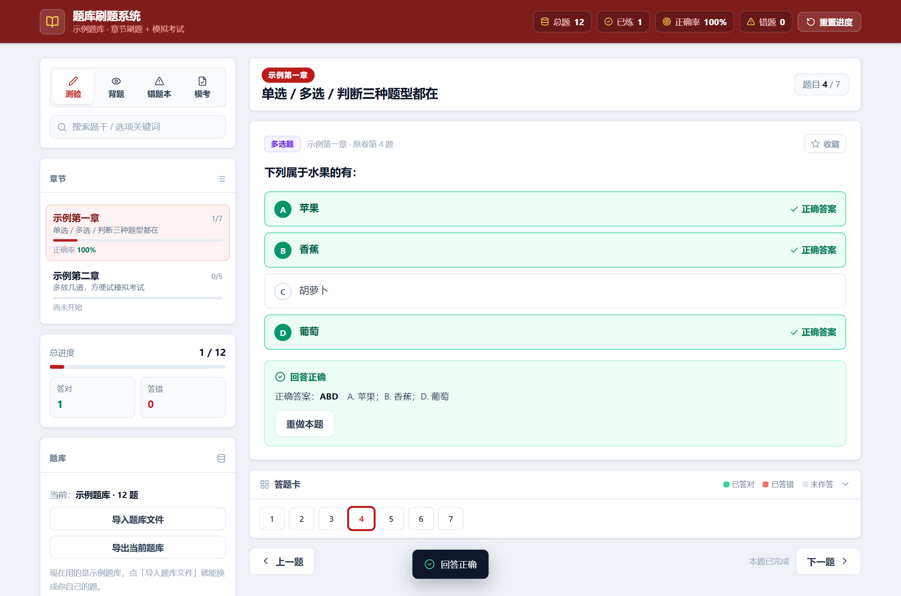
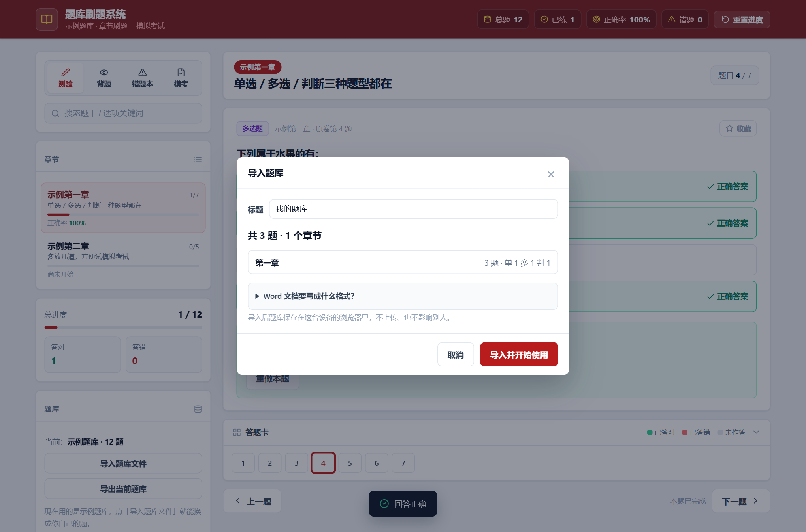

# 题库刷题系统（Word 文档 → 在线刷题 + 模拟考试）

把你自己整理的 Word 题目文档，变成一个能直接双击打开的刷题网页。
不需要服务器、不需要联网、不需要注册账号。



## 为什么会有这个项目

市面上的开源考试系统基本都要求：装 JDK / MySQL / Redis，配后端服务，注册账号，再把题目改成它规定的 Excel 模板导入。为了背一门课的期末，这套流程比复习本身还费劲。

这个项目的取舍正好相反：

- **零依赖**：纯 HTML + CSS + 原生 JS，没有框架、没有构建步骤、没有 CDN
- **零部署**：双击 `index.html` 就能用，手机浏览器打开也能用
- **题库就是一个文件**：`data/question-bank.js`，改题不用碰代码
- **一条命令从 Word 生成题库**：`python tools/build_bank.py`
- **离线可用**：断网、图书馆、考前两小时都没问题

## 快速开始

### 1. 先看效果

直接双击 `index.html`。仓库自带示例题库（12 道题），四种模式都能试。

### 2. 换成自己的题

**方式一：网页里直接导入（不用装任何东西）**

1. 打开 `index.html`，左侧「题库」面板点「导入题库文件」；
2. 选中你整理好的 Word（可以一次多选，比如绪论 + 第一章 + 第二章）；
3. 看一眼解析结果（共多少题、哪些题有问题），点「导入并开始使用」。

题库只存在你这台设备的浏览器里，不上传任何东西。「导出当前题库」可以把它存成文件备份，或者直接发给同学。



**方式二：用脚本批量生成（适合长期维护、题库很大）**

```
① 把 Word 题目文档放进一个目录
   （默认读仓库上一级的 题目文档/，也可以用 -i 指定任意目录）
② python tools/build_bank.py
③ 刷新 index.html
```

换个目录就这样写：

```
python tools/build_bank.py -i "D:\我的题库" --title "我的题库" --subtitle "期末冲刺"
```

两种方式解析的是同一套排版规则，见 [docs/question-format.md](docs/question-format.md)：题号行、选项行、`答案：X` 三行结构。
解析时会自动：

- 按文件名认章节，加新章节不用改代码
- 识别单选 / 多选 / 判断三种题型
- 清掉 Word 里复制粘贴带来的不可见字符
- 报告题号缺口（比如「导论缺第 38 题」），方便回去补
- 跳过读不出答案的题目，并在导入时列给你看

### 3. 发到手机上 / 放到网上

- **局域网**：用任意静态服务器托管这个目录，手机连同一个 Wi-Fi 直接访问
- **长期使用**：推到 GitHub 并开启 Pages（仓库里已带 `.github/workflows/pages.yml`），手机浏览器直接访问网址
- iOS / Android 都可以「添加到主屏幕」，用起来和 App 差不多

## 功能

| 模式 | 说明 |
| --- | --- |
| 测验 | 逐题作答，提交即时判分，支持单选 / 多选 / 判断 |
| 背题 | 直接显示答案，快速过一遍 |
| 错题本 | 答错自动收录，重做答对自动移出 |
| 模拟考试 | 自选范围和题型数量，整卷一起交，交卷后统一判分并逐题解析 |

还有：答题卡（一眼看出哪题答对 / 答错 / 未作答，可任意跳题）、进度与收藏本地保存、题干和选项搜索、键盘快捷键（`←` `→` 翻题，`A`–`D` 或 `1`–`4` 选项，`Enter` 提交）。

模考的题量可以自己配，某题型不够时按实际题量出题，并在面板上提示「XX 只够 N 题」。

## 目录结构

```
index.html               页面骨架，约 170 行
assets/style.css         样式
assets/app.js            全部交互逻辑
assets/import.js         浏览器内解析 Word / 文本，生成题库
data/demo-bank.js        仓库自带的示例题库
data/question-bank.js    你自己的题库（由脚本生成，默认不上传）
tools/build_bank.py      Word → 题库 的转换脚本（只用 Python 标准库）
docs/question-format.md  文档排版规范 & 数据字段说明
docs/roadmap.md          后续计划
```

## 关于题库内容的说明

`data/question-bank.js` 里是你自己的题目，默认写进 `.gitignore` 不会上传，避免教材和教辅内容的版权问题。
仓库里只放系统代码、数据格式说明和一小份示例题。想连题库一起公开，把 `.gitignore` 里那一行删掉即可。

## 常见问题

**双击打开没题目？**
确认 `data/question-bank.js` 或 `data/demo-bank.js` 至少有一个存在且格式正确。
如果还没生成过自己的题库，控制台会出现一行 `ERR_FILE_NOT_FOUND`，那是脚本在探测你的题库文件，属正常现象。

**改了 Word 但页面没变？**
重新运行 `python tools/build_bank.py`，然后强制刷新（Ctrl + F5）。

**做题记录会保存吗？刷新会不会丢？**
不会丢。每答一题、每次翻页、每场模考都会即时写进浏览器本地存储，具体包括：

- 每道题选了什么、判对还是判错（错题本自动跟着更新）
- 收藏了哪些题
- 上次看到哪一章、哪一题
- 模考卷子本身、已作答的选择、已用时间

关掉浏览器、刷新、重启电脑都还在。会在下面这些情况丢：清除浏览器数据、换浏览器或换设备、用无痕模式，
或者换一个地址打开（双击本地文件和用网址访问，在浏览器眼里是两个不同的存储空间）。
如果浏览器根本不允许保存（有些手机上直接打开本地文件会这样），页面会在侧栏直接提示你。

**进度和模考记录混在一起吗？**
不混。平时刷题的进度和模考作答分开存放，互不影响；模考答错的题会自动进错题本。

**导出的文件双击打不开，提示「Internet 安全设置阻止打开一个或多个文件」？**
导出的文件是数据文件，不是程序，不需要双击运行。双击 `.js` 会让 Windows 尝试把它当脚本执行，
而 Windows 会拦截来自 Internet 的下载，所以报这个错。
现在导出的格式是 `.json`，想查看内容用记事本或 VS Code 打开即可；
如果手上还有旧的 `.js` 备份，右键 → 属性 → 勾选「解除锁定」，就能正常打开了。
这个文件的用途是备份、发给同学、或者用「导入题库文件」重新导回来。

## 路线图与许可

后续计划见 [docs/roadmap.md](docs/roadmap.md)。
代码以 MIT 协议开源，题库内容版权归各原作者所有。
